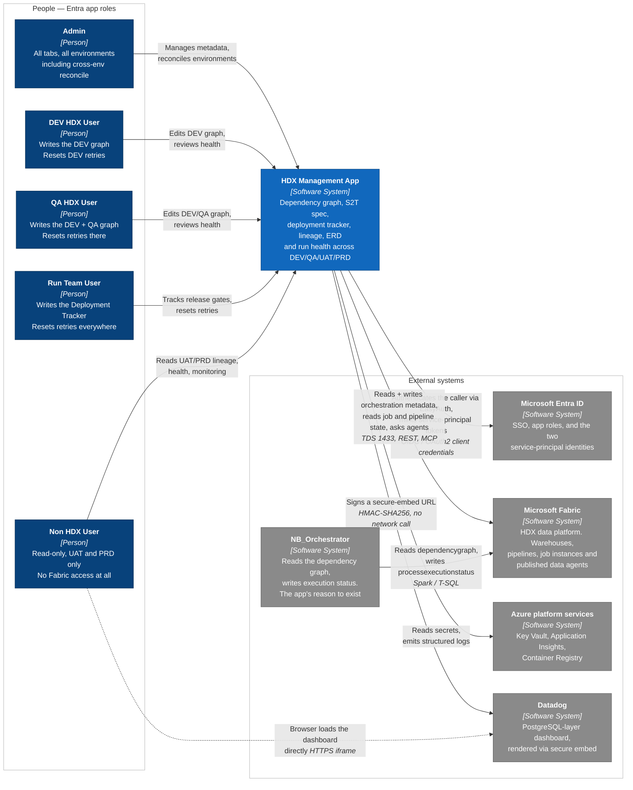
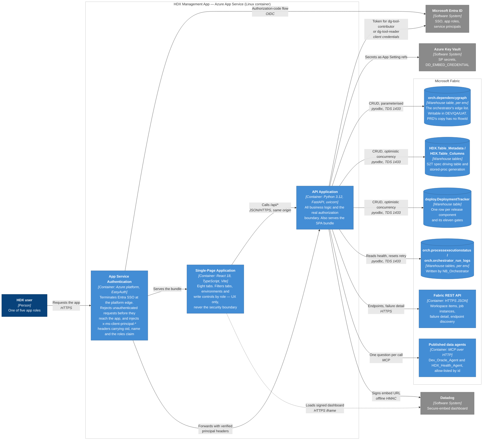
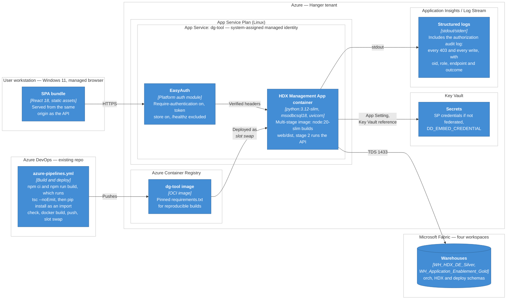

# HDX Management App — C4 Architecture (productionalized target state)

This describes the HDX Management App **as it will exist once deployed as a shared service**, not as
it runs today. Today it is a single-user Windows desktop app: a zip with an embedded
Python interpreter (`package.ps1`), one interactive browser/device-code sign-in, and a
token in a DPAPI-encrypted OS cache. The target is one container on Azure App Service
serving many people at once behind Entra SSO.

Sources: [PRODUCTIONALIZE_PLAN.md](PRODUCTIONALIZE_PLAN.md) (Phases 0–6), the role
tables in [App.tsx:80-180](web/src/App.tsx#L80-L180), and the current
[server/](server/) modules. Where the plan and the code disagree, see
[Known gaps](#known-gaps-before-this-is-buildable) at the end — two of them are
load-bearing and need a decision before Phase 1 starts.

> **On naming.** The application is the **HDX Management App**, matching the
> Confluence SDD. `dg_tool` remains the repository, package and log-namespace name,
> and `dg-tool` remains the proposed Azure/Entra resource name (`dg-tool-contributor`,
> `dg-tool-reader`, the App Service and the container image). Those are identifiers,
> so they are left verbatim throughout — renaming them would break code, grants and
> deployment references.

The diagrams follow C4 conventions — dark blue for people, blue for the system and
its containers, light blue for components, grey for anything outside the HDX
Management App team's control, cylinders for datastores, and a `[Type]` annotation
on every element.

> **Why flowchart and not `C4Context`.** Mermaid's native C4 renderer lays shapes out
> in a fixed two-column grid and places relationship labels at line midpoints with no
> collision avoidance, so at this element count the labels overlap each other and the
> boxes, and `UpdateLayoutConfig` is ignored in Mermaid 12. These are therefore
> `flowchart` diagrams styled to the C4 convention: same semantics, legible output.
> The trade-off is that C4-specific tooling will not parse them.
>
> **Viewing them.** GitHub and VS Code (with a Markdown Preview Mermaid extension)
> render them inline. For [mermaid.live](https://mermaid.live), paste **one diagram
> body at a time** — everything between a ` ```mermaid ` fence and its closing fence,
> starting at the `flowchart LR` line. Pasting the whole file fails on line 1, because
> this heading is Markdown, not Mermaid.
>
> **Publishing to Confluence.** `npm run render` in [confluence/](confluence/)
> re-renders all four to PNG and SVG straight out of this file, so the page cannot
> drift from the doc. Each block's `%% name:` marker sets its attachment filename.

---

## Level 1 — System Context

Who uses the HDX Management App and what it talks to.



**The one relationship that explains the whole design:** the HDX Management App does *not* sit between
the user and Fabric as a delegate. Non HDX User has no Fabric access whatsoever, so
there is no user token to pass through. It authenticates with its own service
principals and does authorization itself — a **trusted subsystem**. Everything in
Level 2 follows from that.

---

## Level 2 — Containers



### Two auth planes, drawn explicitly

| Plane | Mechanism | Establishes |
| --- | --- | --- |
| User → app | Entra SSO via EasyAuth | **Who** you are and which app role you hold |
| App → Fabric | Service principal, client credentials | **What the app can do** — a fixed ceiling, no per-user variation |

`SUSER_SNAME()` will report a service principal on every statement, forever. The
`last_modified_by` column in [s2t.py](server/s2t.py) and the `_author` columns in
[import_tracker.py:351](server/import_tracker.py#L351) become the **only** record of
who did what, and must be populated server-side from the verified EasyAuth claim —
never from a request payload.

---

## Level 3 — Components inside the API Application

```mermaid
flowchart LR
%% name: c4-03-component
    classDef person fill:#08427b,stroke:#052e56,color:#ffffff
    classDef system fill:#1168bd,stroke:#0b4884,color:#ffffff
    classDef container fill:#438dd5,stroke:#2e6295,color:#ffffff
    classDef component fill:#85bbf0,stroke:#5d82a8,color:#000000
    classDef ext fill:#8a8a8a,stroke:#636363,color:#ffffff
    classDef grp fill:#ffffff,stroke:#bbbbbb,color:#333333

    spa["<b>Single-Page Application</b><br/><i>[Container: React 18]</i>"]
    easyauth["<b>App Service Authentication</b><br/><i>[Container: EasyAuth]</i>"]

    subgraph apibox["API Application — FastAPI (server/)"]
        direction TB

        subgraph authz["Authentication and authorization"]
            direction TB
            mw["<b>AuthContextMiddleware</b><br/><i>[Component: raw ASGI, main.py]</i><br/>Decodes x-ms-client-principal-* into a<br/>RequestUser and pins it to a ContextVar<br/>for the life of the request"]
            guard["<b>require, of a minimum role</b><br/><i>[Component: FastAPI dependency]</i><br/>Applied at the router, not per endpoint,<br/>so an endpoint added later is denied by<br/>default. Rejects before any SQL is attempted"]
            fauth["<b>fabric_auth</b><br/><i>[Component: server/fabric_auth.py]</i><br/>Owns both auth planes. RequestUser<br/>ContextVar, principal_tier, and a token<br/>cache keyed on tier and scope"]
        end

        subgraph surface["API surface — main.py routers"]
            direction TB
            graphapi["<b>Dependency Graph router</b><br/><i>[/api/rows*, /api/graph*]</i><br/>CRUD, validation,<br/>cross-env diff and apply"]
            s2tapi["<b>S2T router</b><br/><i>[/api/s2t/*]</i><br/>Metadata and column CRUD,<br/>DDL validation, orphans"]
            deployapi["<b>Deployments router</b><br/><i>[/api/deployments*]</i><br/>Release components<br/>and their eleven gates"]
            healthapi["<b>Health / Lineage / ERD router</b><br/><i>[/api/status*, /api/failure, /api/erd]</i><br/>Execution status, live job polling,<br/>failure root cause, schema graph"]
            chatapi["<b>Data-agent chat proxy</b><br/><i>[/api/oracle-mcp/*]</i><br/>Keeps the Fabric token server-side.<br/>Validates the agent id before use"]
            metaapi["<b>Auth / preflight / health router</b><br/><i>[/api/auth, /api/me, /healthz]</i><br/>Unauthenticated or any-role —<br/>the gate has to be reachable"]
        end

        subgraph dataaccess["Data access and external clients"]
            direction TB
            dal["<b>Query modules</b><br/><i>[queries, s2t, deployments, graph_diff]</i><br/>All SQL text. Natural-key ambiguity checks,<br/>optimistic-concurrency guards"]
            val["<b>validation + models</b><br/><i>[validation.py, models.py]</i><br/>Cycle detection and graph rules,<br/>Pydantic contracts"]
            wh["<b>warehouse</b><br/><i>[server/warehouse.py]</i><br/>Thin pyodbc layer. Per-thread connection<br/>cache keyed on tier, server, database"]
            ep["<b>endpoints</b><br/><i>[server/endpoints.py]</i><br/>Resolves each environment's SQL<br/>endpoint host, once per process"]
            jobs["<b>fabric_jobs</b><br/><i>[server/fabric_jobs.py]</i><br/>Fabric REST client: pipelines,<br/>job instances, failure detail"]
            dd["<b>datadog_embed</b><br/><i>[server/datadog_embed.py]</i><br/>HMAC-SHA256 over nonce and timestamp.<br/>Credential from the environment only"]
            cfg["<b>config</b><br/><i>[server/config.py]</i><br/>Environment table. Defaults, then<br/>config.json, then DG_* env vars"]
        end
    end

    whdb[("<b>Fabric Warehouses</b><br/><i>[DEV / QA / UAT / PRD]</i>")]
    fabricapi["<b>Fabric REST API</b><br/><i>[Container: HTTPS]</i>"]
    agents["<b>Data agents</b><br/><i>[Container: MCP]</i>"]
    entra["<b>Microsoft Entra ID</b><br/><i>[Software System]</i>"]

    spa -->|"XHR /api/*"| easyauth
    easyauth -->|"Verified principal headers"| mw
    mw -->|"RequestUser in ContextVar"| guard

    guard --> graphapi
    guard --> s2tapi
    guard --> deployapi
    guard --> healthapi
    guard --> chatapi
    guard --> metaapi

    graphapi --> dal
    s2tapi --> dal
    deployapi --> dal
    healthapi --> dal
    graphapi -->|"Validates before write"| val
    dal -->|"Parameterised T-SQL"| wh
    wh -->|"Which host?"| ep
    ep --> jobs
    healthapi -->|"Failure detail,<br/>live job status"| jobs
    chatapi -->|"Fabric-scoped token"| fauth
    metaapi -->|"Signed embed URL"| dd
    cfg -->|"Environment table"| ep

    wh -->|"get_token for<br/>the caller's tier"| fauth
    wh -->|"TDS 1433 with<br/>SQL_COPT_SS_ACCESS_TOKEN"| whdb
    jobs -->|"Items, job instances,<br/>activity runs"| fabricapi
    chatapi -->|"initialize, tools-list,<br/>tools-call"| agents
    fauth -->|"Client credentials /<br/>managed identity"| entra

    class spa,easyauth,fabricapi,agents,whdb container
    class mw,guard,fauth,graphapi,s2tapi,deployapi,healthapi,chatapi,metaapi component
    class dal,val,wh,ep,jobs,dd,cfg component
    class entra ext
    class apibox,authz,surface,dataaccess grp
```



### The three components that are new or materially rewritten

- **`AuthContextMiddleware`** — does not exist today. Deliberately a raw ASGI class
  rather than `BaseHTTPMiddleware`, to avoid depending on that wrapper's
  contextvar-propagation behaviour across Starlette versions. It works without
  touching any call site because every route is a plain `def`, so FastAPI dispatches
  via `anyio.to_thread.run_sync`, which copies contextvars onto the worker thread.
- **`require(minimum)`** — does not exist today. Applied at the router so *forgetting*
  is the failure mode being designed against. Per-endpoint discipline is not a control.
- **`fabric_auth`** — keeps the exact signatures of `get_token(scope)` and
  `get_identity()` so `warehouse.py:112`, `fabric_jobs.py:85`, `publish.py:63` and
  `import_tracker.py:351` need no edits. Only the internals change.

---

## Deployment



### Service-principal permission matrix

| Principal | DEV | QA | UAT | PRD |
| --- | --- | --- | --- | --- |
| `dg-tool-contributor` | Contributor (read + write) | *see gap 2* | *see gap 2* | Read |
| `dg-tool-reader` | Read | Read | Read | Read |

SQL principals are created per warehouse with `CREATE USER [...] FROM EXTERNAL
PROVIDER` and least-privilege grants — not `db_owner`. The contributor's write grants
should reach only the three tables the HDX Management App owns: the dependency graph, the S2T pair,
and the deployment tracker.

---

## What changes from today

| Concern | Today | Productionalized |
| --- | --- | --- |
| Distribution | Zip with embedded Python, run per workstation (`package.ps1`, `run.ps1`) | One container image on App Service |
| Sign-in | Interactive browser/device-code against Azure CLI's public client | Entra SSO via EasyAuth, against the app's own Entra registration |
| Token storage | DPAPI-encrypted OS cache, one global identity | In-process cache keyed `(tier, scope)`; two service principals |
| Authorization | Fabric's own per-user permissions; `roles.py` asks Fabric whether you are a PRD workspace Admin | Entra app roles in the `roles` claim; a default-deny FastAPI dependency at the router |
| Audit | `SUSER_SNAME()` is the real person | `SUSER_SNAME()` is a service principal; app-written author columns are the only trail |
| Connection cache | Keyed `(server, database)` | Keyed `(tier, server, database)` |
| Query timeout | Connect-time only (`Connection Timeout=60`) | Plus `cursor.timeout` per query |
| TLS to Fabric | `FABRIC_SSL_VERIFY` defaults to **false** ([main.py:771](server/main.py#L771)) | Defaults to verify-on; disabling is opt-in |
| CORS | Hardcoded `localhost:5173` / `127.0.0.1:5173` / `localhost:4173` | Same-origin; allow-list moved to a `DG_*` env var |
| Health probe | None | `GET /healthz`, excluded from EasyAuth |
| Local dev | The only mode | Unchanged, gated by `DG_REQUIRE_EASYAUTH` being unset |

---

## Known gaps before this is buildable

These are real inconsistencies in the current material, not diagram simplifications.
I drew the diagrams against the code where the two disagree, since the code is newer.

**1. The plan's role model and the code's role model are different.**
[PRODUCTIONALIZE_PLAN.md](PRODUCTIONALIZE_PLAN.md) (11 Sep) specifies three roles —
`HDXUser`, `HDTUser`, `OrgUser` — over seven tabs.
[App.tsx:84-108](web/src/App.tsx#L84-L108) (21 Sep) declares five —
`Admin`, `DevHdxUser`, `QaHdxUser`, `RunTeamUser`, `NonHdxUser` — over eight tabs, with
per-environment write scopes rather than per-tab visibility, and its comment calls them
"the five access levels the deployed app will hold". Phase 0 provisions Entra app roles
by name, so this has to be settled before any Entra work starts.

**2. Two service principals cannot express the five-role matrix.** The plan's
contributor principal is write-capable in DEV only. But
[App.tsx:110-128](web/src/App.tsx#L110-L128) gives `QaHdxUser` graph writes in QA,
`Admin` writes in *all* environments, and `RunTeamUser` retry-reset in all
environments. Either the principal matrix widens (and the "physically cannot write"
property weakens), or a third principal appears, or Admin/QA writes are dropped.
The infrastructure-enforced write ceiling is the main security property of this
design, so this is the decision I would make first.

**3. `roles.py` stops working in production and the plan does not mention it.**
`_identity_claims()` calls `fabric_auth._decode_claims(get_token(SQL_SCOPE))` and reads
`oid` and `groups` off that token to ask Fabric whether the caller is a PRD workspace
Admin ([roles.py:55-129](server/roles.py#L55-L129)). Under the trusted-subsystem model
that token belongs to a *service principal*, so every user would resolve to the same
answer — the SP's own PRD role. `_writable_environment()` calls
`roles.require_admin(env)` on every graph write ([main.py:247-274](server/main.py#L247-L274)),
so this is on the critical write path. It needs replacing with the EasyAuth role claim,
not just re-pointing.

**4. The data-agent chat is still an open decision** (flagged in the plan, unresolved
in the code). `/api/oracle-mcp/chat` proxies free-text questions using the app's own
token. The allow-list at [main.py:965-975](server/main.py#L965-L975) constrains *which*
agent, not what a given person may ask — so it is the widest path from a Fabric-less
Non HDX User to warehouse data. The chat is docked on every tab
([ChatSurface.tsx](web/src/components/ChatSurface.tsx)), which makes the default
maximally exposed.

**5. No automated tests exist**, and the plan explicitly does not introduce any. The
Phase 6 pipeline's only real gate is `tsc --noEmit`. Verification step 5 —
principal isolation under worker-thread reuse — is the one that would catch the most
dangerous class of bug here, and it is currently a manual procedure.
